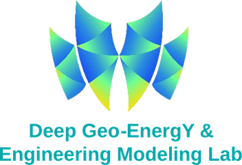
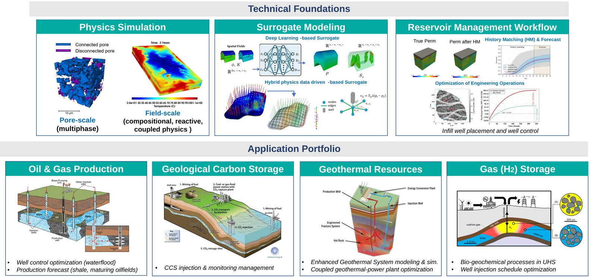
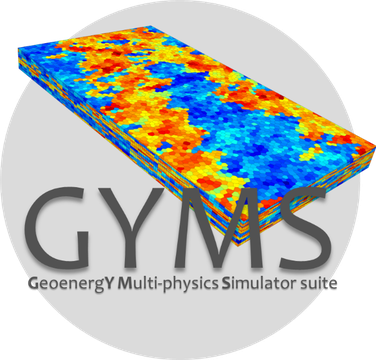
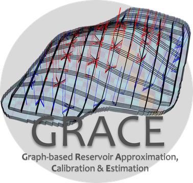

  

# Deep Geo-Energy & Engineering Modeling Lab (DGyM)

We are a research group at [King Abdullah University of Science and Technology (KAUST)](https://www.kaust.edu.sa), led by Prof. Bicheng Yan. We develop **physics-driven numerical simulation** and **data-driven modeling** of fluid flow in porous media, so that complex subsurface processes can be predicted accurately and managed efficiently.

## What we do

- **Physics simulation:** from pore-scale multiphase flow to field-scale compositional, reactive and coupled-physics models
- **Surrogate modeling:** deep-learning and hybrid physics–data-driven (graph-based) surrogates of reservoir simulators
- **Reservoir management:** history matching, forecasting, and optimization of well placement and well control

We apply these to **oil and gas production**, **geological carbon storage**, **geothermal energy** and **underground hydrogen storage**.

## Our software

| Software | Description |
|:---:|---|
|  | **GYMS — Geo-energY Multiphysics Simulator.** Our in-house reservoir simulator for complex subsurface physics: thermal flow (coupled heat transfer, fluid flow and phase behavior) and hydrogen storage (compositional and bio-reactive transport).  📄 Yusifov, H., Yan, B. (2026). GYMS – A Geo-energY Multiphysics Simulator for non-isothermal salt-liquid-vapor flow with applications to diverse geothermal reservoirs. *Computers and Geotechnics*, 200, 108479. [doi:10.1016/j.compgeo.2026.108479](https://doi.org/10.1016/j.compgeo.2026.108479) |
|  | **GRACE — Graph-based Reservoir Approximation, Calibration & Estimation.** A physics-based coarse-grid network surrogate: fast, physics-consistent modeling on coarse grids, deep-learning parameterization to compress geology, to enable efficient and accurate large-scale history matching. |

> **These tools are not open source.** Their repositories are private to the lab. For access, licensing or research collaboration, please contact Prof. Bicheng Yan at [bicheng.yan@kaust.edu.sa](mailto:bicheng.yan@kaust.edu.sa).

## Links

[Website](https://dgym.kaust.edu.sa) · [People](https://dgym.kaust.edu.sa/people) · [Research](https://dgym.kaust.edu.sa/research) · [Publications](https://dgym.kaust.edu.sa/publications) · [Join us](https://dgym.kaust.edu.sa/join-us)

DGyM is part of the Energy Resources and Petroleum Engineering program, Physical Science and Engineering Division, KAUST, Thuwal, Saudi Arabia, and works with the [Geo-Energy & Mineral Resources Platform (GEMs)](https://www.kaust.edu.sa/en/research/research-platforms/geo-energy-mineral-resources-platform).

**Contact:** Prof. Bicheng Yan — [bicheng.yan@kaust.edu.sa](mailto:bicheng.yan@kaust.edu.sa)
